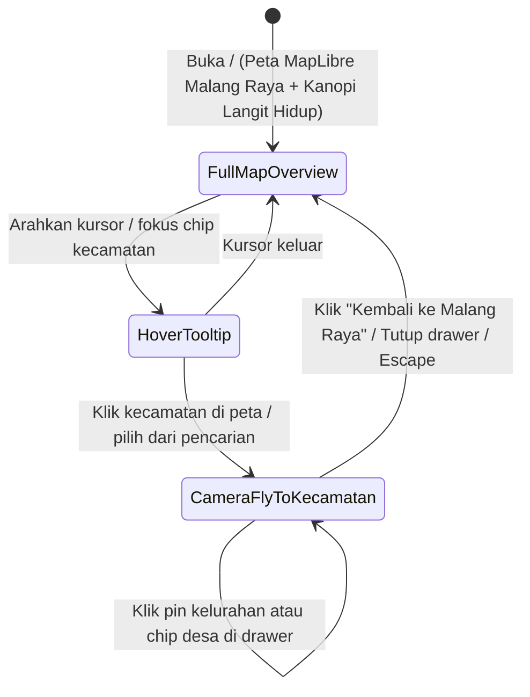

# Design Direction: Tetep Siaga Reks

Dokumen ini adalah acuan visual, interaksi, tipografi, warna, dan tata letak untuk **Tetep Siaga Reks**, dashboard cuaca dan kebencanaan Malang Raya (Kota Malang, Kabupaten Malang, dan Kota Batu) berbasis data resmi BMKG.

Semua keputusan di dokumen ini berpusat pada satu alur inti: **peta Malang Raya realistik penuh satu layar dengan atmosfer cuaca yang hidup, tooltip kaya informasi per kecamatan, serta penerbangan kamera (`flyTo`) dan panel detail wilayah yang berkarakter saat daerah diklik**.

---

## 1. Identitas Produk & Design Read

### Design Read
> Membaca ini sebagai: aplikasi peta cuaca dan kesiapsiagaan interaktif untuk warga serta pelancong Malang Raya, dalam bahasa visual kartografi siang dataran tinggi yang hidup dan ekspresif, dial `ENERGY 3 / RHYTHM 3 / MOTION 2`.

### Three Dials
- **ENERGY 3 (Hidup & Berkarakter):** Kanvas peta geografis asli Malang Raya (gunung, sungai, jalan, garis pantai selatan, dan batas presisi 41 kecamatan) berpadu dengan kanopi langit hidup di cakrawala atas (awan bergerak lembut, pendar cahaya pagi/senja, atau rintik hujan sesuai cuaca) dan kartu cuaca berdimensi tegas.
- **RHYTHM 3 (Komposisi Bervariasi & Editorial):** Layar utama adalah panggung peta interaktif penuh (`100dvh`) dengan kontrol mengambang presisi dan drawer wilayah yang diawali kartu hero langit kontekstual, diikuti kompas arah angin berputar, grafik kurva suhu area, dan strip 3 jam. Halaman `/tentang` dirancang sebagai panduan editorial mikro-iklim Malang Raya (profil elevasi 0 sampai 3.676 mdpl + playbook siaga interaktif), bukan sekadar halaman teks statis.
- **MOTION 2 (Transisi Spasial & Atmosfer Terkendali):** Kamera peta bergerak mulus (`flyTo` dengan kemiringan 3D halus `pitch: 36`) saat kecamatan diklik; atmosfer cuaca bergerak lembut di latar cakrawala dengan tombol **`Jeda efek`** yang terlihat jelas (memenuhi R-39 untuk gerak > 5 detik) serta berhenti otomatis saat `prefers-reduced-motion: reduce`.

### Keputusan Tema Tunggal (R-21 & R-37)
- Sesuai arahan pemilik produk, **aplikasi dikunci pada Mode Terang (Daylight Cartographic)** tanpa tombol ganti tema gelap/terang. Alasannya: peta topografi, kontur pegunungan, dan warna choropleth suhu siang hari paling jernih dan paling hidup dalam palet kartografi terang.

### Identitas Header (R-23)
- Menggunakan wordmark tipografi **`Tetep Siaga Reks`** dilengkapi lencana wilayah kecil `Malang Raya`, tanpa mengarang logo ilustrasi sampai ada arahan khusus.

---

## 2. Alur Interaksi Peta Realistik & Atmosfer Hidup

### 2.1 Peta Realistik (MapLibre GL + GeoJSON Presisi 41 Kecamatan)
- Menggunakan **MapLibre GL** dengan basemap vektor **OpenFreeMap (`liberty`)** yang menampilkan bentang alam nyata Jawa Timur: taman nasional dan hutan pegunungan (Semeru, Arjuno-Welirang, Kawi, Bromo), Waduk Sutami/Karangkates dan Selorejo, jaringan jalan, kota, serta garis pantai Samudra Hindia dan Pulau Sempu.
- Dilengkapi **lapisan relief kartografi bawaan** di kanvas dasar sehingga seandainya koneksi tile eksternal lambat, peta tetap menampilkan warna laut selatan, kontur daratan, dan 41 poligon presisi penuh (`malang-raya-geo.json`, akurasi 5 desimal).
- Setiap kecamatan diwarnai secara semi-transparan mengikuti suhu saat ini (**R1**) sehingga tekstur peta jalan, sungai, dan hutan di bawahnya tetap tembus pandang dan terasa nyata, dipertegas oleh garis batas ganda (*casing* putih + garis batas tegas) dan label nama kecamatan langsung di atas peta.

### 2.2 Lapisan Atmosfer Cuaca Hidup (`WeatherAtmosphere`)
- Di bagian atas kanvas peta terdapat **kanopi cakrawala langit** yang membaur halus ke peta di bawahnya, dilengkapi efek atmosfer sesuai kondisi cuaca aktif:
  - **Cerah / Pagi:** Pendar hangat matahari lereng timur dan awan tipis bergerak pelan.
  - **Berawan:** Lapisan kabut dataran tinggi khas Batu/Pujon yang berarak halus.
  - **Hujan:** Garis rintik hujan diagonal halus di cakrawala atas.
- Dilengkapi kontrol **`Jeda efek`** untuk menghentikan gerak kapan saja, serta pemilih cepat suasana langit di bilah bawah untuk pratinjau Tahap 1.

### 2.3 Tooltip & Klik Wilayah (`RegionDrawer`)
- **Hover:** Poligon kecamatan menyala lebih tajam dan memunculkan `MapTooltip` berdimensi di dekat kursor (nama kecamatan, kab/kota, jumlah desa, ikon cuaca, suhu besar `tabular-nums`, kondisi cuaca, dan ajakan klik).
- **Klik Kecamatan:**
  1. Kamera MapLibre terbang mulus (`fitBounds` + `pitch: 36`) ke kecamatan tersebut sambil memberi ruang di sisi kanan untuk drawer.
  2. Pin kelurahan/desa interaktif muncul di dalam kecamatan tersebut.
  3. URL berpindah ke `/wilayah/[adm4]` dan **`RegionDrawer`** terbuka dengan header kartu langit bergradasi kaya (kontras teks putih `>= 7.6:1`), kompas arah angin, jendela kering (**R2**), saran sadar ketinggian (**R6**), grafik kurva area suhu + batang curah hujan, serta prakiraan 3 hari.
- **Aksesibilitas Keyboard Peta (R-32):** Selain pencarian `LocationCombobox`, tersedia bilah lompat cepat kecamatan yang dapat dinavigasi penuh dengan `Tab` dan `Enter` sehingga pengguna tanpa mouse tetap dapat memilih dan memperbesar wilayah mana pun.

---

## 3. Sistem Warna & Verifikasi Kontras (Daylight Cartographic)

Seluruh pasangan warna diverifikasi menggunakan `contrast-check.py` (WCAG AA minimal `4.5:1` teks normal, `3.0:1` teks besar & batas non-teks).

| Peran | Hex Teks / Elemen | Hex Latar | Rasio Terukur |
|---|---|---|---|
| Teks utama di canvas | `#0F1E26` | `#EEF4F7` | `15.33:1` |
| Teks sekunder di canvas | `#3D525E` | `#EEF4F7` | `7.37:1` |
| Teks utama di permukaan kartu | `#0F1E26` | `#FFFFFF` | `17.02:1` |
| Teks sekunder di permukaan kartu | `#3D525E` | `#FFFFFF` | `8.18:1` |
| Aksen Biru Samudra/Langit | `#0B5394` | `#FFFFFF` | `7.84:1` |
| Teks putih di tombol aksen | `#FFFFFF` | `#0B5394` | `7.84:1` |
| Teks putih di Hero Langit Cerah/Pagi | `#FFFFFF` | `#0E4B80` | `8.99:1` |
| Teks sub di Hero Langit Cerah/Pagi | `#E2F1FF` | `#0E4B80` | `7.81:1` |
| Teks putih di Hero Langit Hujan | `#FFFFFF` | `#1E3A52` | `11.78:1` |
| Teks putih di Hero Langit Senja | `#FFFFFF` | `#8C3B19` | `7.62:1` |
| Batas kontrol UI non-teks | `#6E828E` | `#FFFFFF` | `4.00:1` |
| Badge Aman | `#14532D` | `#DCFCE7` | `8.30:1` |
| Badge Waspada | `#78350F` | `#FEF3C7` | `8.15:1` |
| Badge Bahaya | `#7F1D1D` | `#FEE2E2` | `8.20:1` |

### Skala Choropleth Suhu di Atas Peta Realistik (`fill-opacity: 0.56`)
- `< 20°C` (Dingin pegunungan): `#38BDF8` (Biru es sejuk)
- `20-23°C` (Sejuk lereng): `#2DD4BF` (Toska pegunungan)
- `24-27°C` (Nyaman lembah): `#A3E635` / `#84CC16` (Hijau pucuk)
- `28-30°C` (Hangat perkotaan): `#FBBF24` (Kuning hangat)
- `>= 31°C` (Terik selatan/siang): `#F97316` (Jingga terik)

---

## 4. Halaman `/tentang` (Editorial Mikro-Iklim & Kesiapsiagaan)

Halaman `/tentang` dirancang ulang agar informatif dan menarik dilihat:
1. **Hero Topografi Malang Raya:** Latar langit dataran tinggi hidup dengan siluet kontur pegunungan Malang Raya dan 3 fakta cakupan nyata (`41 Kecamatan`, `471 Desa & Kelurahan`, `3 Wilayah Administrasi`).
2. **Profil Elevasi Malang Raya (0 - 3.676 mdpl):** Visualisasi perbandingan tiga zona iklim lokal Malang Raya (Dataran Tinggi Batu/Pujon/Tengger, Lembah Cekungan Kota Malang, dan Pesisir Selatan Samudra Hindia).
3. **Playbook Siaga Interaktif:** Tab panduan langkah nyata untuk 3 potensi bahaya utama Malang Raya (Gempa Bumi Selatan Jawa, Hujan Lebat & Banjir Lintasan, Angin Kencang Lereng).
4. **Alur Data Resmi & Atribusi Terbuka:** Penjelasan jernih bagaimana data BMKG (Prakiraan ADM4, TEWS Gempa, CAP 1.2) dan batas wilayah MIT diproses.

---

## 5. Batas Dosis & Rasional Keputusan (R-31)

| Aspek | Keputusan | Alasan Satu Baris |
|---|---|---|
| **Peta Utama** | MapLibre GL (`liberty`) + GeoJSON presisi 41 kecamatan + `flyTo` 3D | Menampilkan jalan, sungai, hutan, gunung, dan garis pantai asli sehingga peta terasa nyata dan tidak kaku seperti poligon datar. |
| **Atmosfer Hidup** | Kanopi langit + partikel awan/hujan halus di cakrawala atas + tombol jeda | Menghidupkan suasana cuaca secara langsung di layar peta sambil tetap menjaga keterbacaan peta dan kendali aksesibilitas. |
| **Tema Tunggal** | Fokus penuh pada Mode Terang (tanpa ThemeToggle) | Mengikuti arahan pemilik produk agar kontras warna peta topografi dan choropleth suhu tampil maksimal dan konsisten. |
| **Hero Drawer** | Kartu cuaca utama berlatar gradasi langit gelap kontras tinggi (`>= 7.6:1`) | Menciptakan titik fokus dramatis di dalam panel wilayah sehingga angka suhu raksasa tidak tenggelam di antara kotak putih rata. |
| **Glass & Shadow** | Blur dibatasi maks 2 elemen (HUD atas & tooltip); shadow hanya untuk elemen melayang | Menegaskan bidang apung di atas kanvas peta geografis tanpa membuat seluruh komponen kabur. |
| **Tipografi** | Plus Jakarta Sans dengan `tabular-nums` | Memberi karakter Indonesia modern sekaligus menjaga angka suhu, curah hujan, dan jam tetap sejajar rapi. |
